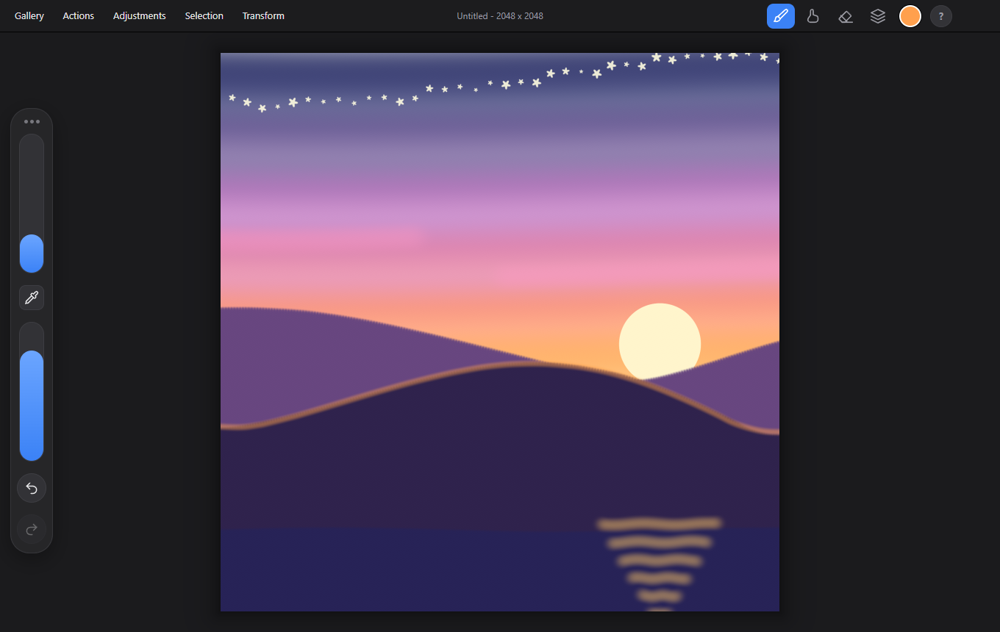
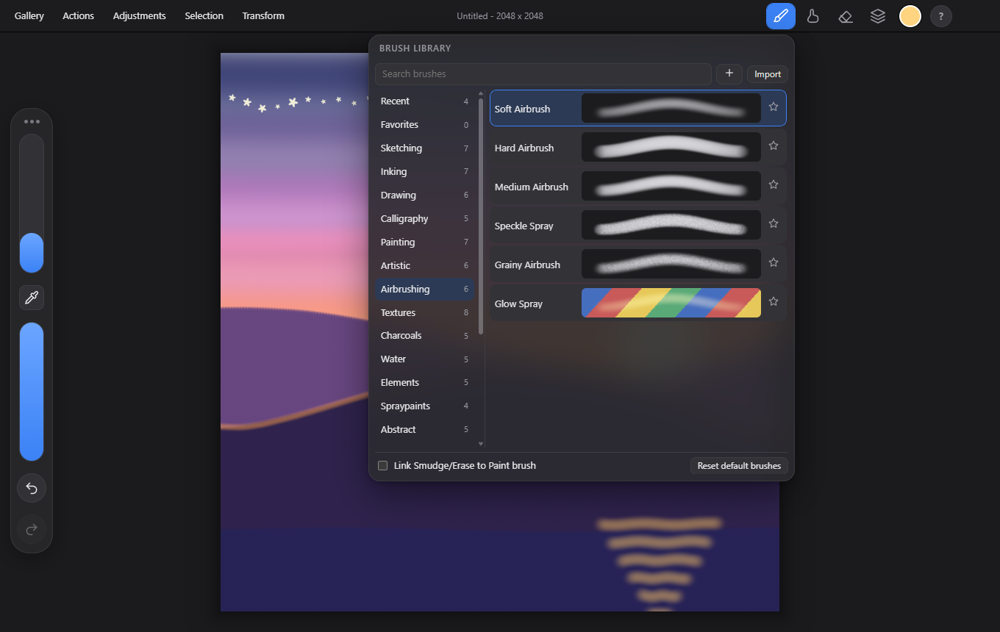
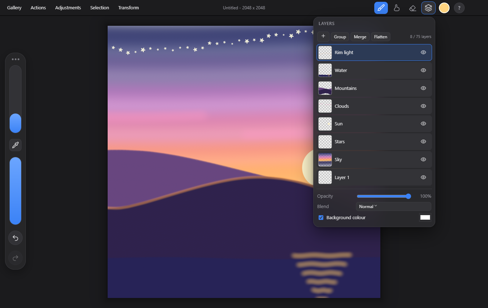
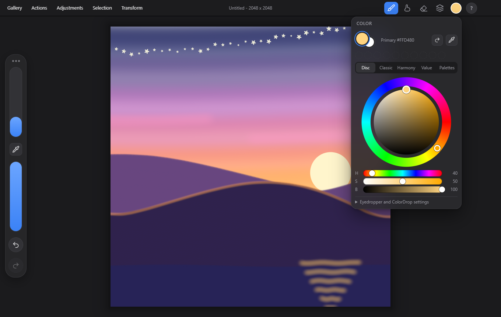
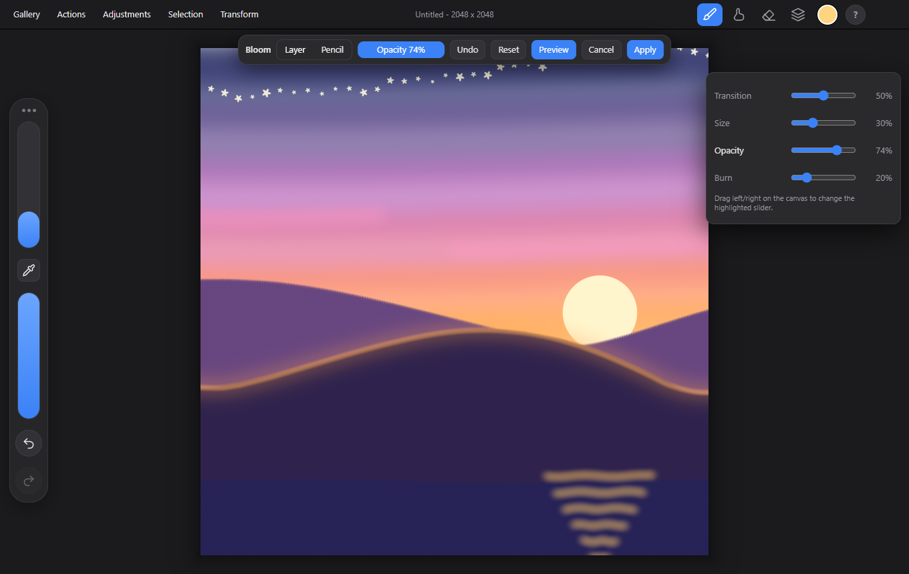
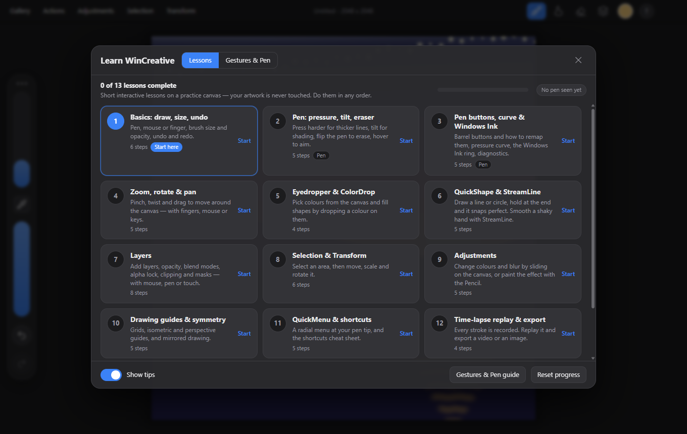

# WinCreative

**English** | [Русский](README.ru.md)

WinCreative is a free, open-source painting app for Windows, inspired by Procreate and built for pen tablets and touch screens.
It is an independent project, not affiliated with or endorsed by Savage Interactive (see [Trademarks](#trademarks-and-branding)).

Electron + TypeScript + electron-vite, with a WebGL2 painting engine.



## Features

* **Tablet support**: pressure, tilt, barrel rotation, pen eraser end, barrel buttons (remappable), hover cursor, editable pressure curve, tablet diagnostics. Works through Windows Ink / Pointer Events (Wacom, Huion, XP-Pen, Surface and others). Touch gestures: pinch/rotate/pan, multi-finger undo/redo.
* **106 soft, anti-aliased brushes** in 19 sets, plus **Brush Studio** to build and tweak your own brushes. Import of `.brush`, `.brushset` and `.abr` is best-effort.
* **Layers**: 26 blend modes, masks, groups, clipping, alpha lock, reference layers, merge/flatten.
* **Adjustments**: Hue/Saturation/Brightness, Color Balance, Curves, Gradient Map, blurs, Bloom, Glitch, Halftone and more, applied to a layer or painted on with the pencil. **Liquify** and Clone included.
* **Selection and transform**: freehand, shape and color selection, free-form transform, warp and distort.
* **Drawing guides, symmetry and QuickShape**: 2D grid, isometric, perspective and symmetry guides with snapping; draw-and-hold to perfect lines, circles and polygons; StreamLine stabilization.
* **Text** with font import.
* **Animation assist** with onion skin.
* **Time-lapse**: every stroke is recorded; replay it, edit it in the time-lapse editor (hide undone actions, pauses, flexible/per-segment speed, fit to a target duration, finale) and export to **MP4** (and image).
* **PSD import/export** (layers, masks, blend modes, text/adjustment layers on import), PNG/JPEG/WebP/TIFF/PDF export, native `.bwk` format.
* **English and Russian UI**, switchable live.
* **Interactive tutorial**: 13 short lessons on a practice canvas, plus a gestures and pen guide.

| Brush library | Layers |
|---|---|
|  |  |
| **Color** | **Adjustments** |
|  |  |



## Install

1. Download the latest installer (`WinCreative-Setup-<version>.exe`) or the portable build from the
   [Releases](https://github.com/lifechangee/WinCreative/releases) page.
2. Requires **Windows 10 or 11, x64**.
3. The installer is **not code-signed**, so Windows SmartScreen will warn ("Windows protected your PC"). Click *More info*, then *Run anyway*. You can also build the app yourself from source (below).

### Tablet tips

* Make sure your tablet driver is installed and, for Wacom/Huion/XP-Pen, that **Windows Ink** is enabled in the driver's settings (needed for pressure in Electron apps).
* Turn off the Windows Ink **press-and-hold ring**: *Settings > Bluetooth & devices > Pen & Windows Ink > Additional pen settings*, and untick "Press and hold for right-click". The gray ring that appears when you hold the pen still breaks long strokes and hold-to-shape. Disable the driver's own "press and hold" option as well.
* Pressure feels off? Open *Actions > Preferences > Pressure & Smoothing* to edit the curve, and run *Tablet Diagnostics*.

## Build from source

Requirements: **Node.js 20 or newer** on Windows (the packaged app and the bundled FFmpeg target Windows x64).

```
npm install
npm run dev        # run in development mode
npm run build      # type-check and build into out/
npm run dist       # build and package installers into release/
npm test           # unit tests (vitest)
npm run selftest   # in-app self tests (launches Electron)
npm run i18n:check # look for hard-coded, untranslated UI strings
```

Project structure and design notes: [ARCHITECTURE.md](ARCHITECTURE.md). Feature checklist: [FEATURES.md](FEATURES.md).
Localisation conventions: [docs/I18N.md](docs/I18N.md). The Playwright-based UI drivers (including the one that makes the screenshots above) live in `scripts/qa/`.

## Status and known limitations

This is an **early version (0.2.0)**. It has been tested mostly with synthetic input and a few tablets, so expect rough edges with some devices and drivers.

* `.procreate`, `.brush`, `.brushset` and `.abr` import is best-effort (the formats are undocumented).
* No CMYK; color management is limited to sRGB-based profiles with ICC embedding.
* Windows only.
* Please report problems (with your tablet model and driver) in [Issues](https://github.com/lifechangee/WinCreative/issues).

## Contributing

Bug reports, translations and pull requests are welcome. See [CONTRIBUTING.md](CONTRIBUTING.md). Changes are listed in [CHANGELOG.md](CHANGELOG.md).

## License

WinCreative is free software licensed under the **GNU Affero General Public License v3.0 or later**.

```
SPDX-License-Identifier: AGPL-3.0-or-later
Copyright (C) 2026 WinCreative contributors
```

The full text is in [LICENSE](LICENSE). Third-party components, including a bundled GPL-3.0 build of FFmpeg used for video export,
are listed in [THIRD_PARTY_NOTICES.md](THIRD_PARTY_NOTICES.md).

**FFmpeg sources.** The bundled `ffmpeg.exe` is FFmpeg 6.1.1 (gyan.dev "essentials" build, commit
[`e38092ef93`](https://github.com/FFmpeg/FFmpeg/commit/e38092ef93)), fetched by
[ffmpeg-static](https://github.com/eugeneware/ffmpeg-static/releases/tag/b6.1.1). Its corresponding source is available from
<https://ffmpeg.org/releases/ffmpeg-6.1.1.tar.xz> and <https://ffmpeg.org/download.html>. Its license text and build info are installed
under `resources/licenses/`.

### Trademarks and branding

The **WinCreative name and logo are not licensed under the AGPL**; all rights are reserved. Forks and redistributions must use a different name and logo.
"Procreate" is a trademark of Savage Interactive Pty Ltd. WinCreative is an independent app inspired by it and is not affiliated with, sponsored or endorsed by Savage Interactive. No Procreate assets are included.
